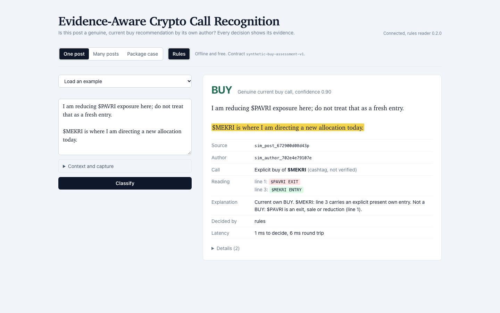

# Evidence-Aware Crypto Call Recognition

Finds the **captured author's own current BUY recommendations** in crypto posts, not just
trading words, and backs each one with evidence IDs from the supplied catalogue.

It reads and writes the assessment package's contract (`synthetic-buy-assessment-v1`).
The package is in [`candidate_package/`](candidate_package/README.md), unchanged, and its
`assessment.py` validates and scores the output. Everything runs offline on the Python
standard library, with no dependencies.

## Requirements

Python 3.10 or newer; tested on 3.12, 3.13 and 3.14. Nothing to install. (macOS ships
Python 3.9 as `python3`; use a newer interpreter, for example `python3.12`.)

## Usage

```sh
PYTHONPATH=src python3 -m evidence_aware_crypto_call_recognition \
  --inputs INPUT.jsonl --output predictions.jsonl
```

- One output object per case ID, in input order.
- `--trace trace.jsonl` also writes the sentence-by-sentence reading behind each decision,
  including the operation found for each asset (entry, exit, short, cover, hold, past,
  hedge).
- Exit codes: 0 means done. 2 means the input file could not be bound to results
  (malformed JSON, duplicate field, non-finite number, missing or duplicate case ID),
  and nothing is written. 3 means at least one output failed the contract self-check,
  which would be a bug.

Optional install: `pip install .` provides the same tools as the `eacr` and `eacr-web`
commands.

## Web UI

```sh
PYTHONPATH=src python3 -m evidence_aware_crypto_call_recognition.web   # http://127.0.0.1:8000/
```

A local page on the standard-library HTTP server, bound to 127.0.0.1:

- **One post**: paste a post, optionally with context posts, a missing prefix or an image
  that was not captured. It is wrapped into a valid package case and classified. The
  cited evidence is highlighted, and the reading shows the operation found for each asset.
- **Many posts**: paste or choose a JSONL file of package input cases and classify them
  all. Loading one of the bundled sets also compares the results with its references,
  with Wilson intervals. Click a row to see that decision. The sets are read from the
  repository checkout, so the list is empty when the package is installed elsewhere.
- **Package case**: paste one input case as JSON. Integrity problems are rejected with
  the package's error codes.

Links such as `/?example=joke`, `/?example=joke&mode=case` or `/?set=development` open a
state directly.
A one-minute walkthrough is in [`assets/demo.mp4`](assets/demo.mp4).



## Reproduce

From the repository root:

```sh
python3 -B candidate_package/verify_package.py            # package files are unchanged
python3 -B -m unittest discover -s tests -t tests          # offline tests (71)
PYTHONPATH=src python3 -B -m evidence_aware_crypto_call_recognition \
  --inputs candidate_package/development.inputs.jsonl --output predictions.jsonl
python3 -B candidate_package/assessment.py validate-outputs \
  --inputs candidate_package/development.inputs.jsonl --predictions predictions.jsonl
python3 -B candidate_package/assessment.py score \
  --inputs candidate_package/development.inputs.jsonl \
  --references candidate_package/development.references.jsonl \
  --predictions predictions.jsonl --report development-report.json
scripts/run_sets.sh python3                                # every set in data/, with intervals
```

## Example

Input case `dev-e0e02c5a82` (primary text, two lines):

```
I am reducing $PAVRI exposure here; do not treat that as a fresh entry.

$MEKRI is where I am directing a new allocation today.
```

Output:

```json
{"case_id": "dev-e0e02c5a82", "status": "OK", "label": "BUY", "confidence": 0.9,
 "current_buys": [{"asset_mention": "$MEKRI", "evidence_ids": ["ev_…"]}],
 "evidence_ids": ["ev_…"],
 "explanation": "Current own BUY. $MEKRI: line 3 carries an explicit present own entry. Not a BUY: $PAVRI is an exit, sale or reduction (line 1).",
 "limitations": ["A stated or claimed action is not verified execution.",
                 "Asset identity is the literal cashtag only; no contract, chain or project identity was checked."],
 "execution_verified": false}
```

## Results

On the package's development set, the package's scorer reports 0 invalid outputs, 3/3
correct integrity rejections, 21/21 accepted labels, 8/8 BUYs with exact asset sets and
0 false BUYs. The reader was written with that set in view, so the first runs on sets it
had not seen are the better guide:

| Set (first run, code frozen) | Fully correct* | BUYs found | Accepted false BUYs |
|---|---|---|---|
| Probe set 2, 30 posts written from the policy | 18/30 (95% CI 0.42–0.75) | 3/12 | 0 |
| 0.1.0 datasets, 147 posts converted to the package format | 87/147 (0.51–0.67) | 20/54 | 9, all on rows labelled `debatable` |

\* Label, asset set, confidence at or above 0.75, and the reference support spans covered.

Missed BUYs were wording the rules did not know, and most of them fell to `NO_NEW_BUY`
rather than producing a false BUY. Those categories were added after each run, so later figures on the same sets are
not accuracy estimates. Details, the confidence table and the known limits are in
[docs/DESIGN.md](docs/DESIGN.md). The dataset shapes are in [data/README.md](data/README.md).

## Layout

- `src/evidence_aware_crypto_call_recognition/`: `integrity` → `segment` → `reading` →
  `decide` → `selfcheck`, driven by `cli`. `evaluate` compares predictions with references.
  `web` serves the local page in `web/index.html`.
- `assets/`: UI screenshot and demo video.
- `tests/`: offline `unittest` suite.
- `data/`: probe sets and the converted 0.1.0 sets, in the package's input and reference
  shapes.
- `scripts/`: probe builder, 0.1.0 dataset importer, runner for all sets.
- `results/`: first-run records, with the hash of the source they ran on.
- `docs/DESIGN.md`: engineering choices, evidence handling, confidence, limits, next steps.
- `candidate_package/`: the assessment package, unchanged.
